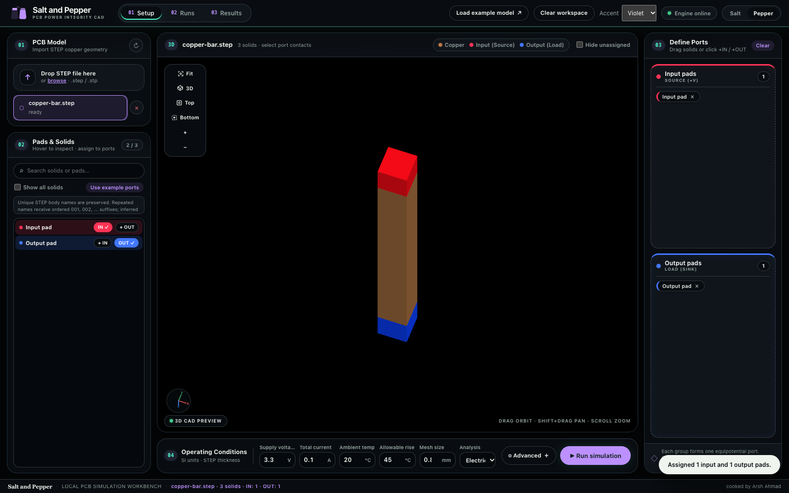
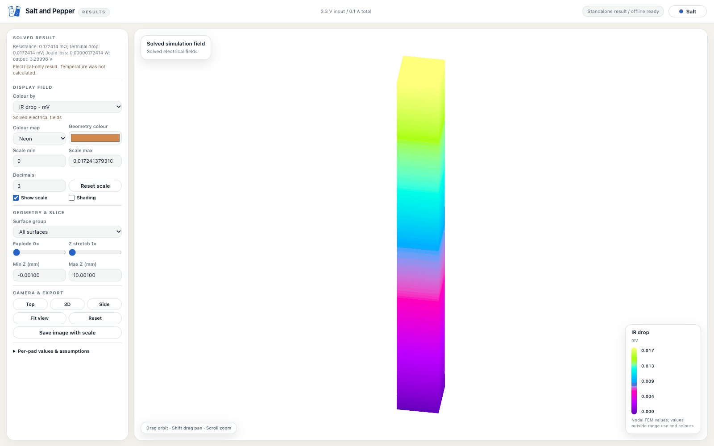
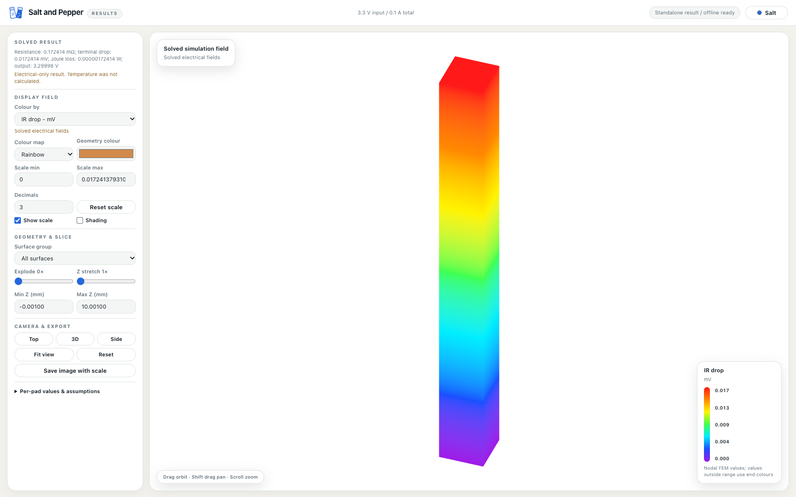

# Salt and Pepper — V0.5

Local PCB electrical and thermal simulation for macOS and Windows. Import STEP copper geometry, select red input pads and blue output pads, and inspect voltage drop, current density and temperature in an interactive 3D viewer. Runs stay on your computer.

[GitHub repository](https://github.com/ahmadarsh/saltnpepper) · [Downloads](https://github.com/ahmadarsh/saltnpepper/releases) · [Build status](https://github.com/ahmadarsh/saltnpepper/actions) · [Wiki](https://github.com/ahmadarsh/saltnpepper/wiki)

## Get started

- **Mac:** open the [Mac DMG](https://github.com/ahmadarsh/saltnpepper/releases/download/v0.5.0/Salt-and-Pepper-0.5.0-macOS-arm64.dmg) and drag **Salt and Pepper.app** onto **Applications**. The app ZIP is also available. Requires Apple Silicon and macOS 14 or newer. The release candidate is ad hoc signed, not notarized.
- **Windows:** run the [Windows x64 EXE installer](https://github.com/ahmadarsh/saltnpepper/releases/download/v0.5.0/Salt.and.Pepper_0.5.0_x64-setup.exe). Requires Windows 10/11 x64. The installer offers Microsoft WebView2 installation if missing. Windows artifacts are produced by the Windows workflow; do not use the Mac executable on Windows.
- **From source:** see [Setup](docs/wiki/Setup.md). Python provides CAD/FEM; Rust/Tauri provides the desktop window. Packaged desktop users do not need to install Python or Rust.

Click **Load example model**, then **Example ports**. Start with electrical analysis, current **0.1 A**, ambient **20 °C**, mesh **0.8 mm**, and finer mesh comparison off. The supplied 1 × 1 × 10 mm copper bar should measure about **0.172414 mΩ** at conductivity 58 MS/m. See [First simulation](docs/wiki/First-simulation.md).

## Project layout

```text
pcb_simulator/        HTTP server, CAD engine, workers and GUI
simulation/           FEM solver and analytical regression tests
examples/             Original, redistributable sample geometry and generator
desktop/              Rust/Tauri shell, native backend packaging, dependency notices
docs/wiki/            GitHub wiki pages and setup guide
licenses/             Project licence texts
tools/                Release assembly and validation
.github/workflows/    Native Mac/Windows build pipeline
```

The release source archive excludes private models, saved simulations, backups, caches and developer environments. Source checkout saves data in `pcb_simulator/data/`; packaged apps use their operating system application-data directory. Upgrading the app does not reset saved data.

## Prepare your KiCad design

1. Configure STEP export to include pads, tracks, filled copper zones, inner copper layers and vias. Keep shapes separate and leave via holes unfilled.
2. Filter the target net in KiCad's export dialog, exclude the non-copper board body and component models, then export.
3. Open the STEP in FreeCAD or another CAD application and inspect the geometry.
4. Note the STEP pad names and positions for every input and output.
5. Import the STEP into Salt and Pepper, find those pads, assign **+IN** / **+OUT**, verify red inputs and blue outputs, then run the simulation.

See the [complete geometry preparation guide](docs/wiki/Prepare-geometry.md) for the export settings and pad-name checks.

## Documentation

[Wiki home](docs/wiki/Home.md) · [Prepare KiCad geometry](docs/wiki/Prepare-geometry.md) · [Setup](docs/wiki/Setup.md) · [First simulation](docs/wiki/First-simulation.md) · [Solver](docs/wiki/Solver.md) · [Building releases](docs/wiki/Building-releases.md) · [Troubleshooting](docs/wiki/Troubleshooting.md)

## Licence

Copyright 2026 Arsh Ahmad and contributors. Software is **GPL-3.0-or-later**; documentation, original icons/artwork and the sample STEP geometry are **CC BY 4.0**. Python generator code remains GPL-3.0-or-later. See [LICENSE](LICENSE), [documentation/model licence](licenses/CC-BY-4.0.txt), and [third-party notices](THIRD_PARTY_NOTICES.md). Third-party components retain their own licences. Creative Commons recommends software licences for code: <https://creativecommons.org/faq/#can-i-apply-a-creative-commons-license-to-software>.

Simulation is an engineering approximation: review mesh convergence and boundary conditions before relying on results. Thermal analysis models copper conduction and approximate convection; it does not include a full PCB dielectric/component thermal stack.

[V0.5 build and test results](docs/Release-validation.md): native Mac arm64 and Windows x64 build jobs passed.

## Roadmap

| Version | Planned scope | Status |
| --- | --- | --- |
| **V0.5** | Current release: local STEP copper simulation and interactive results | **Current version** |
| **V1** | Multiple input and output pads in power integrity (PI) | **In update** |
| **V1.1** | KiCad board import | Yet to start |
| **V1.2** | GPU acceleration for simulation | Yet to start |
| **V1.5** | Basic signal integrity (SI) | Yet to start |
| **V2** | Electromagnetic (EM) simulation | Yet to start |

The current solver already supports multiple selected pads with a shared total current and common input/output potentials. V1 is the planned expansion of that PI workflow. Roadmap entries are plans, not completed features or delivery dates.

## Preview






